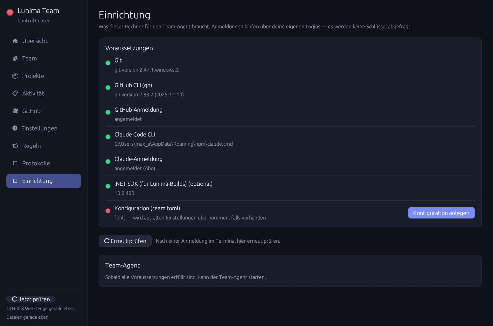

# lunima-agent-loop — the Lunima agent team

Autonomous issue → PR team for the [Lunima](https://github.com/aignermax/Lunima) photonics IDE
and the Akhetonics repositories: one native Rust daemon, **`lunima-team-agent`**, runs every role
on Windows and Linux (no WSL, no Python, Claude on the subscription login, GitHub via the `gh`
login — no tokens in any config):

| role | what it does |
|---|---|
| `coder` | implements `agent-task` issues as PRs (`Agent: …`) into the integration branch (`dev`), repairs `qa-failed` PRs |
| `qa` | builds/tests agent PRs per the repo's `.agent.toml`, posts a verdict, labels `qa-passed` / `qa-failed` |
| `pr-feedback` | implements `@agent …` comments on PRs |
| `product-owner` | one pass per interval: reviews + merges agent PRs, keeps `dev` fresh, grooms and seeds the backlog from `docs/ROADMAP.md` and accepted discovery Decision Records |
| `ux-review` | nightly simulated users walk the desktop app (off by default) |
| `product-discovery` | weekly scout → strategist → critic: evidence with provenance, competing hypotheses, pre-registered experiments, critic-reviewed Decision Records, landing-page and outreach drafts for the maintainer's approval (off by default) — [`docs/DISCOVERY.md`](docs/DISCOVERY.md) |

Architecture, data folder, multi-machine claims and the differences to the former Python
agent / C# loop: [`docs/TEAM-AGENT.md`](docs/TEAM-AGENT.md).

```powershell
lunima-team-agent init          # writes team.toml (imports the old .env / agent-loop.json if found)
lunima-team-agent status        # config, Claude CLI, gh login, repos
lunima-team-agent once product-owner   # one cycle of a role, for testing
lunima-team-agent once product-discovery   # one weekly discovery run (scout → strategist → critic)
lunima-team-agent experiment publish <Lunima clone> <slug> --approved-by <you> --contact <address>
                                # maintainer only: render an approved experiment page into docs/x/<slug>/
lunima-team-agent run           # all roles, forever (scheduled task / systemd user unit)
lunima-team-agent config set roles.product_owner true   # one validated setting (also used by the roles)
lunima-team-agent chat read --role coder                 # the team chat (see below)
```

**Talk to the team.** The Team page of the Control Center shows every role with an on/off
switch and a chat. Write to a role like to a colleague: ask what it works on and why, tell it
something to keep in mind from now on, ask it to switch itself or a teammate on, to add a
repository or to look into the code. A separate Claude session answers with the role's live
status, so the role keeps working meanwhile. Roles store standing instructions in their
memory (part of every later prompt), leave each other notes, ask each other
(`chat ask`, coder → product owner first) and put questions for you into the chat; the
sidebar and the tray show how many wait. Details: [`docs/TEAM-AGENT.md`](docs/TEAM-AGENT.md#team-chat-and-memory).

Configuration is a single `team.toml` in the data folder (`%LOCALAPPDATA%\lunima-team`,
`~/.local/share/lunima-team`); the Control Center edits it. The Product Owner's settings live in
`[product_owner]` (`repo`, `integration_branch`, `base_branch`, `interval_minutes`,
`timeout_minutes`, `max_runs_per_day`, `backlog_min`, `max_turns`, `customer_command`) and the
role is switched on with `[roles] product_owner = true`. Pauses are set per role in the Control
Center (`state/control.json`).

## Installation

Every `v*` tag publishes [release](https://github.com/aignermax/lunima-agent-loop/releases)
assets for Windows (x64, arm64) and Linux (x64, arm64); macOS gets the agent binary only.
Two programs are installed:

- `lunima-team-agent` — the agent daemon (coder, QA, PR feedback, product owner) that runs
  in the background as you, using your Claude subscription and your `gh` login;
- `lunima-po` — the **Lunima Team Control Center** (status, pause/resume, settings, tray icon).

Configuration, state and logs live in the data folder (`%LOCALAPPDATA%\lunima-team` on
Windows, `~/.local/share/lunima-team` on Linux) and are never touched by upgrades or uninstall.

**Prerequisites** (on every machine that runs the agent): `git`; the GitHub CLI `gh`, logged in
(`gh auth login`); the Claude Code CLI `claude`, logged in with your subscription (no API key
needed); optionally the .NET SDK if the agent should build and test Lunima.

### Windows

1. Install `lunima-team-<version>-win-x64.msi` (or `-arm64.msi`). It puts both programs into
   `C:\Program Files\Lunima Team` (on the PATH) and adds the Start-menu entry
   *Lunima Team Control Center*. An older *Lunima Agent Loop* install is upgraded in place.
2. Open the Control Center. Its setup assistant checks git / gh / claude and their logins,
   imports an existing configuration (`.env` of the Python issue agent, `agent-loop.json` of
   the old PO loop) into `team.toml`, and enables the agent's autostart (scheduled task
   `LunimaTeamAgent`, runs at logon as you) and, if you like, the Control Center's own.

Without the UI: `lunima-team-agent init`, then `lunima-team-agent status`, then
`lunima-team-agent run` (or `once coder|qa|pr-feedback` for a single cycle).

### Linux

Debian/Ubuntu:

```sh
sudo apt install ./lunima-team_<version>-1_amd64.deb    # or _arm64.deb
lunima-team-agent init                                  # writes ~/.local/share/lunima-team/team.toml
systemctl --user enable --now lunima-team-agent         # agent in the background (user unit)
lunima-po                                               # Control Center
```

Other distributions: unpack `lunima-team-<version>-linux-x64.tar.gz` and run `./install.sh`
(installs into `~/.local`, user unit into `~/.config/systemd/user`; `sudo ./install.sh --system`
for `/usr/local`; `./install.sh --uninstall` removes it again), then the same three commands.
To keep the agent running while you are logged out: `loginctl enable-linger $USER`.

The Control Center's tray icon needs a desktop with StatusNotifier/AppIndicator support
(GNOME: the *AppIndicator* extension).

### Cutting a release

`git tag v0.5.0 && git push origin v0.5.0` — CI (`.github/workflows/release.yml`) tests the
workspace on every platform and attaches the MSIs, zips, `.deb`s and tarballs to the release.

## Building locally

```sh
cargo test --workspace
cargo build --release -p team-agent -p lunima-po-center
```

Linux needs `pkg-config libgtk-3-dev libxdo-dev libayatana-appindicator3-dev` for the Control
Center. Packages: `dotnet build installer/lunima-team.wixproj -c Release -p:InstallerPlatform=x64`
(Windows, WiX via the .NET SDK), `sh packaging/linux/make-tarball.sh <version> linux-x64` and
`cargo deb -p lunima-po-center --no-build` (Linux, `cargo install cargo-deb`).

## Control Center (tray app)

`lunima-po.exe` (Rust, `control-center/`) shows whether the loop works and what it did — and
lets you fix it without a terminal. It reads the same folder as the CLI (`agent-loop.json`,
`state/`, `logs/`, `prompts/`) and drives the loop through the CLI itself.



*A new machine opens in the setup assistant: it checks git, gh, Claude Code and their logins and
creates `team.toml` with one click.*

| Page | What you see / do |
|---|---|
| **Übersicht** | Traffic light + headline, today's counters, next scheduled run, **health checks** with one-click fixes, recent runs |
| **Aktivität** | Every PO pass: issues created, PRs merged, labels, comments (with links), final report, duration, cost |
| **GitHub** | Newest issues (flags new ones **without** the task label), open PRs (flags wrong base branch) |
| **Einstellungen** | Form over `agent-loop.json` (unknown keys preserved), schedule on/off, "start with Windows" |
| **Regeln** | Edit `prompts/owner.md` / `worker.md` (disk overrides the built-in prompts), restore defaults |
| **Protokolle** | Raw logs incl. the loop's console mirror `logs/loop-<date>.log` (real error behind a failed run) |

Health checks — each one once stopped the loop unnoticed: config/CLI present, `enabled`, pause
(→ *Fortsetzen*), scheduled task missing/disabled (→ *Einschalten*), last PO pass failed (expired
Claude login is called out), worker failure streak, **dirty clone** blocking every worker
(→ *Als WIP sichern*: commits the changes to a local `wip/control-center-*` branch), `gh` login.

The tray icon has the same colour as the traffic light; its menu offers open / pause-resume /
run PO now / quit. Closing the window keeps the app in the tray.

```powershell
lunima-po.exe                          # data folder: LUNIMA_TEAM_HOME, else %LOCALAPPDATA%\lunima-team
lunima-po.exe --home C:\path\to\data    # explicit data folder
lunima-po.exe --tray                   # start hidden (what "start with Windows" uses)
lunima-po.exe --page activity          # open a page: overview|team|projects|activity|github|discovery|settings|rules|logs|setup
lunima-po.exe --page team --screenshot team.png   # render the page, save the window as PNG, quit
```

Build: `cargo build --release --manifest-path control-center/Cargo.toml` (tests: `cargo test`).
Rendering uses wgpu (DirectX 12 on Windows) — Windows-on-ARM GPUs have no OpenGL 2+.

## UX tester — Claude clicks through the real app

`tools/ux-tester/ux_tester.py` closes the gap the headless pipeline cannot: nobody in the
worker → test-gate → PO chain ever *uses* the app. The tester launches Lunima on an unlocked
desktop session and lets Claude (computer use, `computer_toolset_20260801`) walk the manual
items of `docs/RELEASE-CHECKLIST.md` like a user — clicking, typing, zooming into small text —
while judging like a UX designer: right-sidebar clutter, overlapping components/routes,
walls of help text, missing feedback. After every action it measures whether the window is
hung (Win32 `IsHungAppWindow`) and tells Claude how long, so "the UI hangs" becomes a number.

```
pip install anthropic pyautogui mss pygetwindow pillow
set ANTHROPIC_API_KEY=...
py -3 tools/ux-tester/ux_tester.py ^
   --app "C:\...\Lunima-dev-ki\CAP.Avalonia\bin\Debug\net10.0\CAP.Avalonia.dll" ^
   --checklist "C:\...\Lunima-dev-ki\docs\RELEASE-CHECKLIST.md" --max-steps 150
```

Output: `tools/ux-tester/reports/<stamp>/report.md` (+ `findings.json`, screenshots,
`transcript.jsonl`). Add `--file-issues --lunima-clone <path>` to open one GitHub issue per
finding (label `ux-finding`, `--min-severity major` by default); screenshots are pushed to a
`ux-findings/<stamp>` branch so they render in the issue. `--attach` reuses a running window,
`--scenarios file.txt` adds your own steps, `--limit N` trims the list.

Do not touch mouse or keyboard while it runs; moving the mouse into the top-left corner aborts
(pyautogui fail-safe). Budget: a 150-step run on Fable is roughly 20–40 minutes and a few dollars
in screenshots; prompt caching is on.

## Independent customer role → Product Owner

The desktop tester runs before each Product-Owner pass when `[product_owner]
customer_command` is set (e.g. `python tools/ux-tester/customer_cycle.py --repo aignermax/Lunima
--base dev --feedback "%LUNIMA_CUSTOMER_FEEDBACK%"`); the PO reads the evidence file. The customer role uses Claude's [computer-use toolset](https://platform.claude.com/docs/en/agents-and-tools/tool-use/computer-use-tool)
to operate the real Windows app. It receives persona goals, not source code or a
developer's click recipe. It assesses task completion **and** visual hierarchy,
consistency, typography, spacing, discoverability, feedback and recovery.

```
scheduled run / own
  → independent customer: new PR head(s) + integration baseline
  → evidence and scenario verdicts in state/customer/feedback.md + .json
  → PO reads customer evidence before merge / prioritization
  → deduplicated, outcome-based issues for the coder role
  → worker PR / updated commit → new customer review
```

Every review checks out the requested commit into a fresh directory, builds
`CAP.Desktop/CAP.Desktop.csproj`, and launches that output. The working Lunima clone
is never checked out, reset or cleaned by the customer. Drafts, forks and unrelated
PRs are excluded; eligible PRs target the integration branch and carry `agent-pr`
or an `Agent:` title. Reviews use least-recently-attempted order, with new commits
first and the baseline winning ties. A failing baseline or older PR cannot keep
later PRs waiting indefinitely, even with a one-review budget.

The bundled goals in `tools/ux-tester/customer_scenarios.json` cover Ingrid's first
use, Jonas learning and composing logic, Peter editing precisely and inspecting
the manufacturing path, and a design coherence review. The customer reads a brief
derived from issue #537's latest North star and the integration commit's
`docs/ROADMAP.md` and `docs/PERSONAS.md`: education-first **NAND2TETRIS for photonics**,
gates → circuits → systems, visible computation and eventual fabrication.
The complete versioned sources are saved in `state/customer/strategy.json`; their
fingerprint participates in acceptance identity. Unavailable sources block the
cycle, and source changes during a run invalidate its acceptance. The customer
gets product intent and persona definitions, without implementation/rung notes
or prescribed clicks. It restates its understanding in the transcript for the
PO to check. Future roadmap ambitions are not treated as shipped features, and
simulation/DRC-lite/GDS export are never proof of foundry readiness.
Edit the **trusted runner-side** scenarios to add a targeted journey for a new
feature; the six default journeys do not cover every possible feature.
For each PR, the PO must also write `state/customer/goals/pr-<number>.json` with
`sha` set to the current PR head and a nonempty `goals` array using the same
`id/persona/goal/success` schema. The PO receives these instructions automatically.
Missing/stale PR-specific goals block acceptance: generic smoke journeys alone
cannot approve a feature they never exercise. The next scheduled pass tests the
combined goals; no human needs to copy the report between roles. These are simulated
users, not human research or a guarantee that a redesign is good.

### Set up once, after merging

Use a dedicated, unlocked Windows test desktop/account or VM, Python 3.11+, .NET 10,
`git`, authenticated `gh`, and `ANTHROPIC_API_KEY` in the scheduled task's environment.
Do not use the mouse/keyboard while the customer runs. A shared everyday desktop
can contain notifications and user data even when captures are cropped to the app.
The test process supplies fresh profile environment directories to Lunima, but
this is **not an OS sandbox**: Windows known-folder APIs can still resolve the
account's normal folders. Use a dedicated account with only public test fixtures.

```powershell
python -m venv .customer-venv
.customer-venv\Scripts\pip install -r tools/ux-tester/requirements.txt
lunima-team-agent once product-owner   # customer evidence, then the PO
```

`customer_command` is any shell command; it runs in the PO's clone with
`LUNIMA_CUSTOMER_FEEDBACK` pointing at the evidence file the PO reads
(`state/customer/feedback.md` in the data folder). The tool's own options (`--model`,
`--project`, `--max-reviews`, `--max-age`, `--max-steps`, `--max-turns`, `--timeout`) go on that
command line; see `python tools/ux-tester/customer_cycle.py --help`.

Pausing the product-owner role also pauses the customer. State caches
are keyed by repo, PR, commit, goals, strategy sources, model and harness policy. New commits invalidate
old results; a push during a review blocks the result. Infrastructure blocks retry
after an hour; normal verdicts expire at the configured age. A per-cycle lock
prevents two customer sessions sharing the same state directory from using the
desktop concurrently. Use one runner/state directory per test desktop.

### Evidence and acceptance

- `PASSED`: every goal has an interaction, an observation and an existing screenshot;
  no failed goals or major/critical findings; the model ended normally.
- `NEEDS_CHANGES`: observed failed goal or major/critical friction.
- `BLOCKED`: locked desktop, missing key/dependency, wrong build, failed launch,
  interrupted/budget-exhausted run, incomplete coverage or missing evidence.
- `PENDING`: not run yet because the per-cycle budget was reached.

Every meaningful action receives a fresh screenshot. Customer input is bounded to
the launched app's process/window; a focus change ends the session rather than
clicking another app. Reports, model transcripts and screenshots remain local in
`state/customer/runs/`. Nothing is automatically uploaded or filed by this role.
Run directories include builds and can grow large; archive/remove old completed
runs during maintenance, while retaining evidence for any accepted current PR.

The PO is instructed to accept only fresh `PASSED` evidence for the current PR head,
compare the SHA immediately before merging, and use `--match-head-commit`. This is
a **PO workflow rule**, not a GitHub branch-protection check: human/admin merges
outside the loop are unaffected. Baseline evidence never approves a PR. Blocked
test infrastructure is not filed as a product defect. The PO converts actual UX
findings into deduplicated issues for the existing worker, with persona, goal,
reproduction and retest criteria, and may choose to create no new feature tasks.

### Validate the integration without a desktop or API calls

```powershell
python -m unittest discover -s tests -p "test_customer*.py" -v
```

The tests drive the real report loop with scripted API/desktop adapters. They do not
substitute for a live customer run after setup.

## Requirements

- `git`, the [GitHub CLI](https://cli.github.com/) (`gh auth login`) and the
  [Claude Code CLI](https://code.claude.com/) (logged in with the subscription) on `PATH`
- whatever the target repos build with (Lunima: .NET 10 SDK)
- Rust (stable) to build from source: `cargo build --release --workspace`

## Notes & limitations

- **Desktop availability.** Mechanical tests can run headlessly. The optional customer role
  requires an unlocked test desktop; locked sessions are explicitly `BLOCKED`, never UX-passed.
- Prompts are compiled in (`crates/team-core/prompts/`); a file of the same name in the data
  folder's `prompts/` overrides one (the Control Center's rules editor writes those).
- A crashed worker can leave a stale `agent-running` claim behind; the Product-Owner pass
  removes claims older than ~6 h so the issue is retried.


### Codex with ChatGPT

The loop and role chat can use the Codex CLI with a ChatGPT login. To switch,
set the following in `team.toml` (or set `runner.backend` and `runner.model`
in the Control Center settings / `lunima-team-agent config set`):

```toml
[runner]
backend = "codex"
model = "gpt-6-astra" # verified locally; empty string uses the Codex CLI default
```

Run `codex login` interactively first. `lunima-team-agent status` and the setup
assistant show the selected CLI and check for ChatGPT authentication. Existing
configurations without `[runner]` keep Claude; `backend = "claude"` restores the
existing model/endpoint policy.

Codex selection overrides all repository routing (`kimi`, `kimi-only`) and
model labels (`eco`, `complex`, `critical`, `claudeapi`), including reviewer,
QA, PR feedback, Product Owner, discovery stages, and every role's chat. It
uses `runner.model` everywhere, ignoring the Claude role models. API keys and
endpoint overrides are removed from Codex child environments. No personal
Codex apps/plugins or user configuration are loaded. Backend changes apply
on the next cycle/new chat answer; already running sessions finish with their
original backend. A Claude usage-limit pause does not block Codex.

Codex has no equivalent to Claude's `max-turns`: those budgets do not cap a
Codex session. Existing per-role hard deadlines still apply; sessions without
one have a two-hour hard deadline. Chat has a 20-minute deadline. Inactivity
and memory guards remain active. Native events are normalized to the existing
session-log format, so the activity parser is unchanged. Restricted discovery
jobs retain their explicit tool boundary; they must never fall back to an
unrestricted session.

The nightly UX desktop tester is a separate Python program that calls the
Anthropic API, not a loop CLI session. It is unavailable while Codex is
selected, with an explicit status/log explanation, even if `roles.ux_review`
is enabled; its role chat does use Codex. External commands such as
`product_owner.customer_command` are not converted to Codex: review those
separately if configured. Switching the runner does not install tools, alter
credentials, restart processes, or change any live settings by itself.


The Control Center has a durable dropdown under **Einstellungen → Runner →
Backend für alle Rollen und Chat**:

- **Claude (Abo / Repo-Routing)** retains the existing per-repository and label policy.
- **Codex (ChatGPT-Abo)** uses the ChatGPT subscription for all sessions.
- **OpenRouter / Kimi (API-Key)** uses `providers.openrouter` globally.
- **Moonshot / eco (API-Key)** uses `providers.eco` globally.
- **OpenAI / Responses-kompatibel (API-Key)** uses `providers.openai` globally
  through Codex's API runner. Configure its base URL, model and key-file path
  or key environment-variable name in the OpenAI API settings group.

API selections override every role/chat model and repository/label policy.
OpenRouter/eco require the Claude CLI for its Anthropic-compatible protocol;
OpenAI-compatible endpoints require the Codex CLI and Responses support.
Missing configured keys fail explicitly, without subscription fallback. The
selector preserves all existing keys and endpoint settings. `runner.model`
applies only to the Codex subscription; API choices use their endpoint's model.
The OpenAI API backend has the same hard-deadline behavior as Codex subscription.
The standalone UX desktop tester remains Anthropic-based; no API selector
converts that Python program into another provider.

The bundled commit-comment check also runs under Codex: a native PostToolUse
hook starts an independent read-only review using the selected model/provider.
It requires Node.js and Codex CLI 0.169.0; it does not call Claude or modify
global hook settings. Findings ask the worker to remove unnecessary comments
and amend the commit. See [hook behavior and validation](crates/team-core/assets/codex-hooks.md).

Restricted discovery sessions have no shell or personal connectors. Existing
discovery Markdown/JSON/TOML/text files and prepared `.discovery` context are
supplied in a bounded local snapshot; editing uses `apply_patch`. Context above
1 MB is rejected explicitly. Codex sessions also receive an instruction to
honor the repository's `CLAUDE.md` alongside `AGENTS.md`.
The global Claude SessionStart memory behavior is retained by loading the current
user's `~/.claude/memory/*.md` notes directly (up to 256 KB). The wmux terminal
telemetry hooks are not installed in the background runner.
